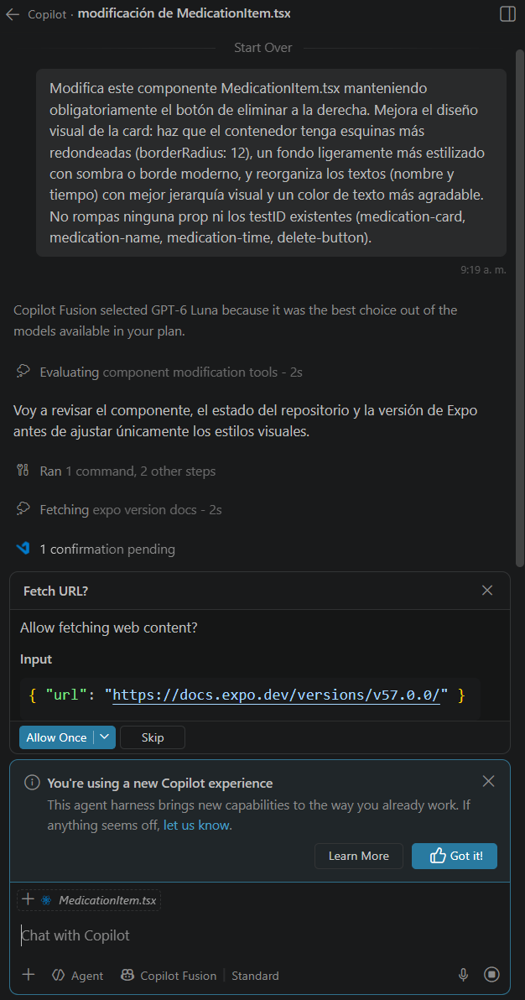
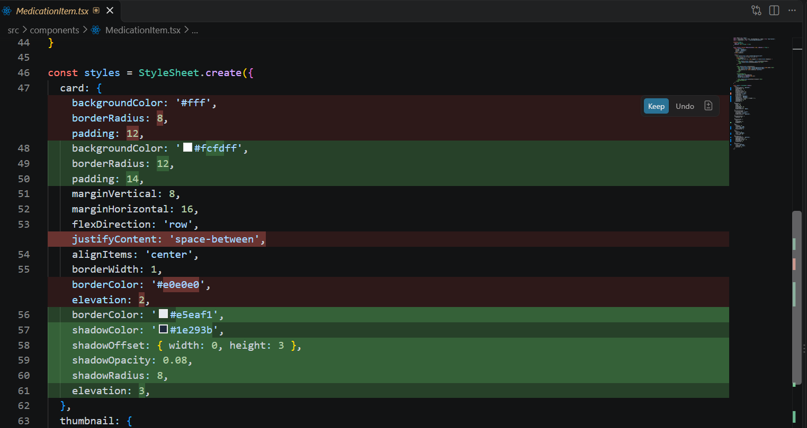
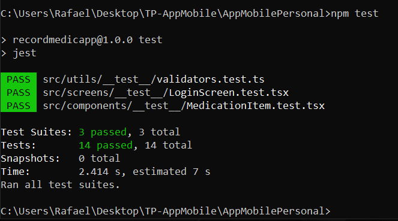

# 💊 App Recordatorio de Medicación

**Alumno:** Rafael Enrique Cortez

**Opción elegida:** App Recordatorio de Medicación (React Native + Expo 57)

---

## 📹 Video Demo
* [Enlace al Video Demo en Google Drive](https://drive.google.com/drive/folders/1kRSyKpsZ0mebsp_1xk-GjtGOJvndL8Wd?usp=sharing)

---

## 🚀 Funcionalidades Implementadas
- **Autenticación local y estado global:** Registro de usuarios con validaciones e inicio de sesión gestionados mediante `Zustand` y persistidos en `AsyncStorage`.
- **Navegación por pestañas (Bottom Tabs):** Acceso rápido entre las secciones de **Medicamentos** y **Médicos** adaptado a los márgenes seguros del dispositivo.
- **Gestión de recordatorios con multimedia:** Alta y listado de medicamentos con configuración de tiempo personalizado, alertas nativas (`expo-notifications`) y foto opcional desde cámara o galería (`expo-image-picker`).
- **Gestión de médicos y recursos nativos:** Registro de profesionales con asignación independiente de:
  - **Ubicación (`expo-location`):** Coordenadas GPS, altitud, precisión y dirección aproximada, con ingreso manual alternativo ante rechazo de permisos.
  - **Contactos (`expo-contacts`):** Búsqueda en la agenda del dispositivo o carga manual de contacto.
  - **Calendario (`expo-calendar`):** Creación de eventos para próximos turnos directamente en el calendario nativo, con fallback manual.
- **Pruebas unitarias:** Suite de tests con Jest y React Native Testing Library para validaciones, pantallas y componentes.

---

## 🤖 Uso de Inteligencia Artificial

Ejemplo del uso de GitHub Copilot para modicacicones de los estilos de la Interfaz de Usuario.

### Ejemplo de Prompt Utilizado
> *"Modifica este componente MedicationItem.tsx manteniendo obligatoriamente el botón de eliminar a la derecha. Mejora el diseño visual de la card: haz que el contenedor tenga esquinas más redondeadas (borderRadius: 12), un fondo ligeramente más estilizado con sombra o borde moderno, y reorganiza los textos (nombre y tiempo) con mejor jerarquía visual y un color de texto más agradable. No rompas ninguna prop ni los testID existentes (medication-card, medication-name, medication-time, delete-button)."*

### Evidencia del Proceso
1. **Solicitud al agente de IA:**
   

2. **Modificación aplicada en el código (`MedicationItem.tsx`):**
   

---

---

## 🧪 Pruebas Unitarias (Tests)
> **Resultado de la ejecución de los tests (`npm test`):**
> 
> 

---

## 🛠️ Cómo ejecutar la aplicación

1. **Clonar el repositorio:**

   ```git clone <URL_DE_TU_REPOSITORIO>```

2. **Ir a la ruta raíz del proyecto**

3. **Instalar las dependencias:**

    ```npm install```
    
    Si llegas a tener algún conflicto de dependencias o versiones en tu entorno, puedes forzarlo ejecutando: ```npm install --force```

4. **Iniciar la aplicación:**

    ```npx expo start```

    O con limpieza de caché: ```npx expo start -c```
