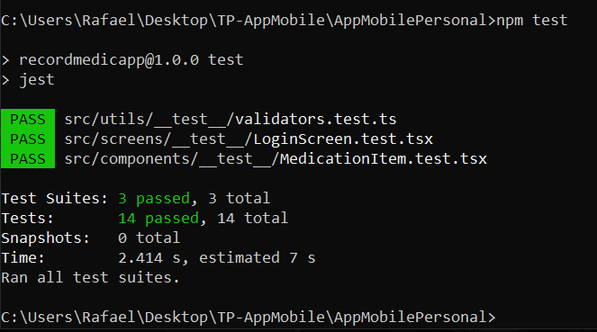

# 💊 App Recordatorio de Medicación

**Alumno:** Rafael Enrique Cortez

**Opción elegida:** App Recordatorio de Medicación (React Native + Expo 54)

---

## 📹 Video Demo
* [Enlace al Video Demo en Google Drive](https://drive.google.com/file/d/1BLTY7jkEGAzhF2Xb_ZGdvNCJZjbZVQRG/view?usp=sharing)

---

## 🚀 Funcionalidades Implementadas
* **Autenticación local:** Registro de usuarios con validaciones e inicio de sesión utilizando `AsyncStorage`.
* **Gestión de recordatorios:** Pantalla principal (Home) que lista los recordatorios y permite eliminarlos.
* **Creación de alertas:** Formulario de alta para nuevos medicamentos con configuración de tiempo personalizado (segundos, minutos u horas).
* **Notificaciones locales:** Programación de alertas nativas en el dispositivo mediante `expo-notifications`.
* **Pruebas unitarias:** Suite de test con Jest y React Native Testing Library para validaciones, pantallas y componentes.

---

## 🧪 Pruebas Unitarias (Tests)
> **Resultado de la ejecución de los tests (`npm test`):**
> 
> 

---

## 🛠️ Cómo ejecutar la aplicación

1. **Clonar el repositorio:**

   ```git clone <URL_DE_TU_REPOSITORIO>```

2. **Ir a la ruta raíz del proyecto**

3. **Instalar las dependencias:**

    ```npm install```
    
    Si llegas a tener algún conflicto de dependencias o versiones en tu entorno, puedes forzarlo ejecutando: ```npm install --force```

4. **Iniciar la aplicación:**

    ```npx expo start```

    O con limpieza de caché: ```npx expo start -c```
